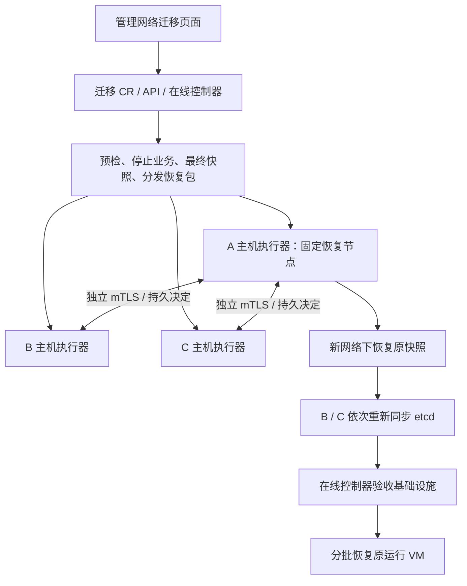

# 集群管理网 IP 迁移功能设计

状态：设计草案，尚未实现，尚未通过三节点改址演练。

## 1. 产品行为与适用范围

提供“集群管理网络迁移”功能：客户填写所有节点的新管理 IP、掩码、网关、DNS 和新管理 VIP，经预检后，在维护窗口停止业务，在原三台机器上保留系统、磁盘和设备绑定，恢复原 Kubernetes 资源数据，并以新地址重新组成控制平面。

首版采用整集群业务停机方案，不承诺 VM 连续运行。允许 Longhorn 单副本、Local PV、HostDisk、GPU/HBA PCI 直通、CPU host-passthrough 和绑核；这些配置改变停机及恢复检查，不要求为迁移额外增加节点。CPU host-passthrough 与 GPU PCI 直通分别识别。

首版产品支持目标：三个健康的 control-plane/etcd 节点，静态 IPv4，现有 NetworkManager 管理接口及其 VLAN/bond/MTU 保持不变，仅修改 L3 地址、路由、DNS 和 VIP。外部交换机/路由器由客户事先配置。迁移不修改 Pod CIDR、Service CIDR、业务 VM 网络及独立存储网。

不能迁移的条件：节点离线、etcd 不健康、卷故障、仍有业务写入者、配置来源无法识别、未支持的 CNI/版本组合、磁盘身份不明确、恢复包不完整或无法阻止旧控制平面自动启动。DHCP、IPv6、修改 VLAN/NIC/bond/MTU、节点增减和同时升级系统留到后续版本。

有外部独立存储网时允许其保持原配置；管理网本身兼作存储或迁移网络时纳入探测。管理网段与 Pod/Service、业务网、Kube-OVN 等现有网络的重叠必须经过路由分析，存在冲突则阻止执行。

2026-11-09 只读核对的版本参考：6.99 为 `v1.8.2-hci.3.0.0.1`，RKE2 为 `v1.35.7+rke2r1`，openEuler，NetworkManager。该环境只有一个节点，不能作为三节点支持证据。产品启用以经过验证的版本、构建摘要和拓扑兼容矩阵为准。

## 2. 核心方案

使用 RKE2 快照恢复机制，在原节点上恢复原集群的 Kubernetes 数据，并重建 etcd 成员关系。保留原 CA、token、节点名称、Node UID（由原快照恢复）、PV/PVC UID、Longhorn 磁盘标识和直通设备绑定。

etcd 成员关系和其内部 ID 可以重建；这不等于新建空 Harvester。虚拟机磁盘数据原地保留，不进行全量搬盘，不格式化、不重装、不删除 Kubernetes Node 或 Longhorn Node/Disk/Volume。

该方案基于 RKE2 已有恢复能力，但不是已经验证的 Harvester 通用改址流程。必须先完成版本适配与故障注入，才能开放执行入口。禁止调用安装器 `scripts/wnt/reset-cluster-network.sh`；该脚本面向空集群并清理更多状态。

最关键的架构约束：Kubernetes API 停止后，不能再依靠 Kubernetes Job、DaemonSet、Lease 或普通控制器推动进度。API 在线时负责计划和交接，API 离线时由独立的主机 systemd 服务执行。



## 3. 组件与代码归属

| 组件 | 代码归属 | 职责 |
| --- | --- | --- |
| 迁移 CRD、API、控制器、Webhook | `harvester` | 计划、权限、集群锁、预检、停业务、交接、恢复后验收 |
| 独立主机执行器二进制 | 建议 `harvester/cmd/harvester-network-migrator` | 本地事务日志、配置备份、网络切换、RKE2 恢复、节点间协调、离线 CLI |
| 二进制打包、systemd unit、启动保护 | `harvester-installer` | 将执行器持久安装到 OS，确保 RKE2 停止或主机重启后仍能运行 |
| 网络配置来源适配 | installer + network controller | 识别管理接口及配置所有者，阻止并发修改，持久化新配置 |
| UI 页面、模型、路由、国际化 | `harvester-ui-extension` | 旧/新地址对照、预检、停机确认、进度、入口切换、恢复业务 |
| Rancher 配置所有权适配 | 先定位现有 API；确有需要时改 `rancher` | 更新本地集群期望配置、节点计划及管理入口，避免旧地址被重新下发 |

复用 `ShutdownPlan` 中 VM 原状态记录、正常停机、卷卸载检查的语义，提取公共 helper；不直接创建一个会继续触发整机下电的 ShutdownPlan。现有 HostNetworkConfig 或网络检查接口不能直接承担整集群离线恢复。

执行器安装在持久目录，由 systemd 管理；可由在线控制器完成分发和验证，但不作为容器内的临时进程运行。首版不要求升级后即可执行，必须确认每台执行器版本与主机适配器均已就绪。

## 4. 资源与 API

新增集群级资源 `ManagementNetworkMigration`，组 `harvesterhci.io/v1beta1`。一个集群只允许一个活动迁移，并与升级、关机、节点移除、维护、存储网修改互斥。互斥必须是后端共享锁及各入口强制检查，不能只隐藏按钮。

输入示意，地址为文档示例：

```yaml
apiVersion: harvesterhci.io/v1beta1
kind: ManagementNetworkMigration
metadata:
  name: management-network-change
spec:
  strategy: OfflineSnapshotRestore
  expectedClusterUID: "<kube-system-namespace-uid>"
  recoveryNode: node-a
  target:
    vip: 192.0.2.100
    accessURL: https://hci.example.com
    dnsServers:
      - 192.0.2.53
    nodes:
      - nodeName: node-a
        nodeUID: "<original-node-a-uid>"
        addressCIDR: 192.0.2.11/24
        gateway: 192.0.2.1
      - nodeName: node-b
        nodeUID: "<original-node-b-uid>"
        addressCIDR: 192.0.2.12/24
        gateway: 192.0.2.1
      - nodeName: node-c
        nodeUID: "<original-node-c-uid>"
        addressCIDR: 192.0.2.13/24
        gateway: 192.0.2.1
  workloadResumePolicy: Manual
  recoveryEvidenceRef:
    name: customer-recovery-evidence
```

旧配置由后端探测并固化，不接受用户填写的旧地址作为执行依据。固定恢复节点与完整节点集合进入签名清单，execute 后不可变。任何输入或现状变化都会使旧预检摘要失效。

建议 actions：`prepare`、`execute`、`cancel`、`retry`、`requestRollback`、`resumeWorkloads`。创建资源和 prepare 不会停机或改网。execute 必须携带最新 `planDigest`、`preflightDigest` 和一次性确认 nonce；重复请求返回同一操作，不重复执行副作用。

status 分离 `phase`（Draft/Preparing/Prepared/Running/Blocked/Failed/InfrastructureReady/Succeeded/RolledBack）与 `stage`（具体步骤），保留 `lastCompletedStage`、`operationID`、`epoch`、observedGeneration、节点进度、阻塞原因、快照摘要、各验收项及新入口。Blocked 不覆盖断点。

RBAC 为专用集群级管理权限。prepare/execute/rollback/恢复业务均通过后端鉴权和审计；请求体不接收 shell、命令、任意文件路径或登录凭据。CR、日志和支持包不保存 token、私钥或 kubeconfig。

## 5. 预检与评审结果

预检输出“阻止执行”和“影响提示”，每项含证据和修复建议。单副本、本地盘和 GPU 直通本身不作为拒绝原因。

必须检查：

1. 三节点身份及角色、etcd 成员和多数派、API 健康、版本及构建摘要匹配、执行器可用。
2. 新 IP 唯一性、VIP 不与节点冲突、CIDR/网关合法性、路由冲突、DNS/时间服务和防火墙策略。ARP 探测不等于地址预留，目标网段不可达时不能声称已排除冲突。
3. 对现有管理接口保持不变的场景，可受控添加临时辅助地址进行节点间目标网络探测，结束后清理。探测会修改主机网络，必须由独立明确的网络探测动作触发；普通 prepare 保持只读。
4. 目标网暂时不可用时，报告“未验证”，首版在实际目标网络证明可达前不发放恢复许可；外部端口切换作为维护窗口中的显式等待步骤。
5. VM → 卷 → 实际副本节点关系，包括运行于另一节点但依赖本节点唯一副本的 VM。所有卷故障均阻止开始；单副本健康状态允许停机迁移。
6. 其他 PVC 使用者、外部使用 Harvester CSI 的来宾集群、备份/重建/快照任务、NFS 或第三方 CSI 等。无法停止或证明静默的写入者阻止快照交接。
7. 本地盘的磁盘序列号/WWN、挂载点及节点亲和性；GPU/HBA PCI 标识、claim、驱动绑定；CPU 模型、绑核、NUMA 需求。保存清单用于同机恢复验证。
8. VM 正常关机能力、关机超时和 guest agent 状态。首版禁止自动强制断电；超时进入 Blocked，由客户处理后重新检查。
9. 配置来源及其摘要、NetworkManager profile UUID、现有存储路径、快照和配置包的磁盘空间。
10. 管理 HTTPS 证书、RKE2 服务证书的 SAN、FQDN 解析、外部 Rancher/备份/监控等依赖清单。无法自动处理的外部依赖必须明确标为人工步骤。
11. 独立数据备份的恢复证据、带外控制台和回退网络条件。程序能校验已接入的备份，不能凭用户勾选声称独立备份可恢复；只有本机快照时产品必须阻止“已具备数据保护”的声明，首版执行门槛要求有效的独立恢复证据。

评审页展示完整旧/新地址对照、业务停机范围、唯一副本分布、原机绑定、固定恢复节点、备份状态、预期管理入口中断及外部系统处理项。用户在同一次维护操作中确认执行，不在每台节点上重复确认。

## 6. 在线准备、停业务和最终快照

1. 获取共享操作锁，固化完整计划、节点身份与配置摘要。
2. 分发执行器与恢复所需制品，预加载本地镜像；恢复期间不能依赖已失联的镜像仓库、DNS 或下载地址。
3. 暂停所有已识别的配置写入者：Rancher/Rancherd 节点计划、网络控制器及冲突操作。保存暂停状态，支持恢复。不得只停一个服务却留下其他控制器继续回写旧 IP。
4. 设置维护写入屏障，拒绝 VM 启动、卷和节点变更等冲突请求；授权迁移操作使用受限内部身份。暂停外部 GitOps/自动化，不能仅依靠 UI 互斥。
5. 保存所有 VM 原始 runStrategy/running、调度约束、节点和设备信息；正常停止 VM 及其他卷使用者。保存前为运行状态、因维护变为 Halted，恢复时仅按清单还原。
6. 等待 VMI 消失、所有相关 Longhorn 卷分离、其他存储静默。检查 libvirt/QEMU 和直通设备实际释放，不能仅检查页面 Off。
7. 写入 `FinalSnapshotPending`，创建最终 etcd 快照，记录 checksum、revision、时间和快照 ID。验证可读取并具备恢复所需 token/原 CA；完整恢复能力在兼容性演练中验证。
8. 将最终快照、原状态清单、配置前后差异、制品摘要和恢复 manifest 持久化到三台节点及独立备份位置。每台实际读取并校验；不能只检查上传返回成功。
9. 所有节点回报 Prepared 后，发放绑定 operationID/epoch/planDigest 的执行授权，交给主机服务。

最终快照中的 VM 必须已停止，避免恢复 API 后自动启动到存储和网络尚未就绪的节点。VM 原运行状态另存于持久 manifest，不依赖恢复快照中的中间 status。

## 7. 离线主机执行协议

每台节点持久保存 root-only 目录：

```text
/var/lib/harvester/network-migration/<operation-id>/
  manifest.json
  journal.jsonl
  decisions/
  config-before/
  config-after/
  snapshot/
  reports/
```

包含快照和敏感配置的部分须加密或依托受保护的加密存储，权限至少 0700/0600；密钥恢复方案必须独立于正在恢复的 etcd。manifest、journal、普通报告不含秘密。写入使用临时文件、fsync 和原子 rename，日志记录步骤开始、证据、完成和重试结果。

主机服务由 systemd 启动，不依赖 RKE2/containerd。提供受限的节点间 mTLS 通道和本地 Unix socket CLI：

```text
harvester-network-migrator status --operation <id>
harvester-network-migrator resume --operation <id>
harvester-network-migrator request-rollback --operation <id>
harvester-network-migrator export-report --operation <id>
```

节点证书及信任材料在在线阶段预置，校验节点身份、操作摘要与 epoch；端口待实现时分配，只绑定管理接口、仅允许参与节点的旧/新地址，完成后关闭。浏览器不直接调用这个有 root 能力的通道。进度查询不能授予执行任意命令的权限。

固定 A 为唯一恢复节点，B/C 永远不能因“等不到 A”自行恢复快照。首版不自动选举替代恢复节点；A 故障时进入人工恢复。仅能在证明 A 已被隔离且签发新 epoch 后更换恢复节点，防止形成两个携带原数据的活动集群。

离线步骤：

| 步骤 | 完成条件 |
| --- | --- |
| FenceRuntime | 全部节点持久禁止 Rancherd/system-agent/RKE2 自启动，安装早期启动保护 |
| StopRuntime | 停止 RKE2，确认原 etcd、kubelet/容器等相关进程不会继续提供旧控制平面；仅 systemctl inactive 不足以证明容器已停止 |
| ApplyNetwork | 原子更新持久网络配置和节点配置，应用新地址，保留配置备份 |
| ProbeTargetNetwork | 所有主机从目标地址完成 mTLS 互联、路由及必要端口验证 |
| AuthorizeSeedRestore | A 收齐三台同 epoch 的停止证明、配置摘要、新网连通证明，持久化唯一恢复许可 |
| RestoreSeed | A 在正确的新配置、原 token/CA 下，按版本适配器恢复最终快照并重建 etcd 成员关系 |
| RepairDesiredState | 使用本机 API 修正恢复出来的旧 VIP、管理 URL、Rancher 计划等；验证无旧地址回写 |
| JoinPeers | B 的旧 etcd db 隔离归档后重新同步；B 成为健康投票成员后再处理 C |
| ValidateInfrastructure | 三成员健康、API/节点/CNI/存储/入口/直通设备通过后交回在线控制器 |

所有节点必须回报已阻止自动启动的证据，A 才能恢复。主机断电重启时先由迁移 guard 检查 journal，不能启动旧控制平面；guard 的 systemd 排序早于 Rancherd、system-agent 和 RKE2。

RKE2 启动只能由当前阶段的明确许可放行。仅有 Kubernetes Lease 过期、HTTP 超时或长时间收不到其他节点消息，都不能作为抢占、恢复快照或启动旧实例的授权。

网络不互通或协调消息丢失时允许暂停，并从本地控制台恢复；不承诺网络分区下全自动继续。静态目标地址清单和本机 CLI 可在 DNS/API 不可用时使用。

## 8. 配置适配与写入一致性

建立版本适配器接口：`Discover`、`Validate`、`Render`、`Apply`、`Verify`、`RestoreBeforeImage`。不进行全盘字符串替换，不对未知 YAML 文件批量替换 IP。

至少覆盖：

- NetworkManager 的实际 profile、IP、路由、DNS；按 UUID 绑定，不能固定假设连接名称。
- `/oem/harvester.config` 的管理地址、VIP、serverurl，防止未来重生成网络时恢复旧配置。
- Rancherd 配置及实际生成的 RKE2 文件（6.99 存在 `40-rancherd.yaml`）。
- Rancher 管理的期望配置、机器计划及其来源（不能只修改 `50-rancher.yaml` 的生成结果）。
- RKE2 合并后的 `node-ip`、`node-external-ip`、`advertise-address`、server、tls-san；探测实际配置覆盖顺序与启动脚本。
- `harvester-system/vip`、入口 Service、kube-vip、Harvester/Rancher 管理 URL 及安装持久配置。
- 主机防火墙：离线阶段预置旧/新节点允许集合，避免 Node 状态尚未更新时新地址被阻止。完成后去掉临时允许项。
- CNI/Flannel 以及实际启用的 Kube-OVN 管理 underlay 地址；未知 CNI 拒绝执行。Pod/Service 网段维持不变。

首次写入前检查文件和资源版本与计划摘要一致。在线旧配置、离线文件、恢复后期望配置三者使用同一份渲染结果；每个所有者恢复调谐前先更新其源配置并验证不会回写。无法实现有界暂停和配置交接的所有者属于首版阻塞项。

## 9. 证书策略

保留原集群 CA、token 和信任链。按版本适配器处理 API/etcd 服务证书及 peer 证书的新地址 SAN，不能假设默认续期一定重建所有 SAN，也不能删除整个 tls 目录。

新 IP、新 VIP、新入口域名涉及的服务证书在停止前尽可能准备并校验，恢复时确保 peer/server TLS 可用。保留旧 SAN 至回退窗口结束，适用范围由证书所有者决定。

自定义企业 HTTPS 证书由客户提供匹配新入口的证书；原域名保持不变且证书仍有效时优先保留。程序校验 SAN、有效期、链和私钥匹配，不代替企业 CA 私钥签发。

离线主机协调使用独立操作身份，不能依赖正在轮换的 Kubernetes 服务证书。其有效期覆盖维护和恢复窗口，主机时间异常或身份材料失效时阻止破坏性操作。

## 10. 持久状态、重复执行和回退

同一步骤执行前读取真实状态及 journal：已完成且证据仍匹配则跳过，状态不明则校验或 Blocked。快照恢复、旧 db 归档、节点加入均设独立检查点；没有明确证明不得重复恢复快照覆盖后续进度。

etcd 快照恢复会把 CR 的 status 和锁回退到拍摄时刻。因此交接之后，主机持久日志和已签署的决定记录是执行事实来源；API 恢复后先重建迁移状态和互斥，再让控制器继续。禁止根据恢复出来的旧 CR 自动重新 execute。

每个操作使用 operationID、epoch、固定 seed、planDigest、snapshotDigest；所有节点核对一致。旧 epoch 的 execute、rollback、启动许可一律拒绝。

| 边界 | 可执行动作 |
| --- | --- |
| 执行授权前 | cancel：清理暂存和探测配置，恢复已暂停的控制器；若已停 VM，只恢复原状态清单 |
| 已授权、尚未恢复 seed | 协调回退网络和配置；必须确认没有已发放且仍有效的 seed 恢复许可。无法收齐撤销/隔离证明则保持停机，转人工处理 |
| seed 已开始恢复，业务未恢复 | 全体保持 fenced，以回退 epoch 在旧网恢复同一最终快照，再让 B/C 重新同步 |
| VM 已开始写入 | 不能自动恢复维护前快照；在当前最新集群数据上创建新的反向迁移计划，或走数据恢复流程 |

执行授权后不设置“失联几分钟自动切回旧 IP”的单机定时器。各节点各自回退可能使部分节点启动旧 etcd；回退必须是同一操作、同一 epoch 下的集群决定。无法证明状态时进入 NeedsOperatorRecovery，不继续启动 VM。

回退前也要隔离停止当前 seed 和所有 peer。旧 etcd db 仅作为取证和恢复材料，不将三份旧 db 同时放回启动。操作中保留配置和快照，不在成功之前自动删除；保留期结束后按显式清理策略移除。

## 11. 验收与业务恢复

基础设施验收：三个 etcd 投票成员及 endpoint 健康、无异常告警、API ready、Node UID/name 和新 IP 匹配、跨节点 Pod/DNS/Service 正常、主机端口策略正确、新 VIP HTTPS 验证成功、无配置回写。

存储验收：PVC/PV UID 与原清单一致；Longhorn Node/Disk 身份、配置的副本数及实际可用副本符合预期，无故障或意外新建磁盘。停止状态的卷允许 detached/unknown 等正常状态，不能错误要求所有卷必须 attached/healthy。启动后再检查挂载与读写。

直通验收：原机的 GPU/HBA 及磁盘仍匹配物理标识，claim、驱动、IOMMU 资源可用，VM 原调度约束保留；CPU 模型、绑核、NUMA 需求在原节点仍可满足。

达到基础设施就绪后保持 VM 关闭，进入 InfrastructureReady。用户从新入口执行一次“恢复原运行虚拟机”，按可配置批次和依赖次序恢复原运行清单，原本关机的 VM 保持关机。可提供明确选择的自动恢复策略，首版默认人工触发。

平台自动检查 VMI Ready、卷挂载和设备分配；GPU 任务、数据库一致性和业务读写由配置的验收探针或客户验收。没有业务探针时记录为未验证，不能显示“业务已验证成功”。

VM 启动失败时冻结后续批次、保存失败原因，允许针对失败步骤重试；不自动回滚整个控制平面。平台验收完成且业务验收结果已记录后结束操作，释放写屏障和共享锁，恢复原控制器状态。

## 12. UI 行为

入口建议为“集群 → 运维 → 管理网络迁移”，与现有安全关机页面并列。

页面顺序：填写新网络 → 只读预检/受控网络探测 → 影响与备份评审 → 确认维护并执行 → 恢复新入口 → 验收并恢复原运行 VM。

执行前提供可下载的脱敏恢复说明、operationID、三台新地址、预期管理 URL、离线 CLI 和证书信任说明，不下载 token/私钥。用户确认时明确展示“全部 VM 停机，管理页面将暂时无法连接”。

API 离线后页面保留最后确认的阶段，显示“管理连接中断，节点执行器正在处理；当前进度待重连确认”，不伪造实时百分比、不将断连当作成功或失败。可让用户显式打开新入口；不在后台向任意用户填入的目标发送登录 token。

新入口须正常完成 TLS 验证并验证 expectedClusterUID/operationID。跨 origin 不复制浏览器 token，不降级 HTTPS，必要时重新登录。恢复页从持久报告和重建的 CR 状态展示各节点实际进度。

## 13. 验证计划与开放门槛

必须先验证的工程问题：定制 RKE2 的新地址快照恢复、Rancher/Rancherd 的配置暂停与重新下发、systemd 启动保护覆盖所有入口、停止 RKE2 后残余容器的停止、当前 Canal/Kube-OVN 组合、Longhorn 单副本的同机识别与恢复、现有端口保护策略的离线适配。

测试不在客户业务集群或直接在 6.99 上执行破坏性改址。使用同版本三节点测试环境，完成：

1. 静态 IPv4 换网段、同网段换 IP、VIP 变化、域名不变/变化、新旧网络不互通。
2. Longhorn 三副本、单副本、多 VM 交叉依赖唯一副本、磁盘近满、Local PV/HostDisk。
3. 真实 GPU/HBA 直通、CPU host-passthrough/绑核、重启后的设备绑定；仅模拟不能算硬件验证通过。
4. 每个状态边界的进程退出、节点断电、seed 故障、网络分区、磁盘满、损坏快照、错误 token、证书失效。
5. 重复 execute、过期计划、旧 epoch 请求、恢复快照导致 CR 回退、控制器重启、并发升级/关机/节点变更。
6. 新网故障下协调回退、seed 恢复之后的旧网恢复、VM 已写入后拒绝旧快照自动回退。
7. 配置来源重新调谐和三台逐台重启后的持久性验证、CNI 实际流量、存储及业务读写、GPU 实际任务。
8. RBAC、脱敏报告、离线通道认证、地址验证、命令注入、未授权节点请求、支持包秘密过滤。

只有上述关键场景通过，才把对应 build/topology 标记为 Supported。未通过的构建仅提供预检和报告，不能靠“强制执行”跳过兼容性门槛。

## 14. 分阶段交付

第一阶段：只读发现、兼容性与预检报告、网络差异预览、恢复说明；没有停机或改网能力。

第二阶段：主机执行器、离线协调、启动 fencing、事务日志、快照恢复和回退，在隔离三节点环境完成验证，内部特性开关控制。

第三阶段：接入 UI、RBAC、互斥、备份证据、外部依赖清单、业务恢复和完整验收，按兼容矩阵开放客户使用。

后续再评估在线逐节点改址、DHCP/IPv6 和 VLAN/NIC 变更。首版不同时提供两种执行引擎，避免把 etcd 在线成员更新和离线快照恢复混在一个事务里。

## 15. 现有代码与参考

- `pkg/apis/harvesterhci.io/v1beta1/shutdownplan.go`：持久化阶段、VM 原状态与节点进度模式。
- `pkg/controller/master/shutdownplan/controller.go`：正常停 VM、卷分离和交接检查。
- `pkg/controller/master/rancher/register.go`、`tls_secret.go`：VIP、入口 Service、服务证书关联。
- `pkg/controller/master/setting/ssl_certificate.go`：管理 HTTPS 证书入口。
- `pkg/hostportaccess/`：管理和节点端口保护。
- installer `pkg/config/templates/rancherd-config.yaml`：node-ip、node-external-ip、advertise-address 来源。
- installer `pkg/config/templates/rke2-90-harvester-server.yaml`：VIP/SAN 配置。
- installer `package/harvester-os/files/usr/sbin/harv-update-rke2-server-url`：启动前 server URL 改写。
- UI `pkg/harvester/pages/c/_cluster/safeshutdown/index.vue`：集群级操作页面参考。
- network controller `pkg/controller/agent/hostnetworkconfig/`：主机网络调谐冲突分析入口。
- RKE2 官方快照恢复流程：<https://docs.rke2.io/datastore/backup_restore>。

本次仅新增设计文档，不修改上述运行逻辑、不部署、不执行改址。
